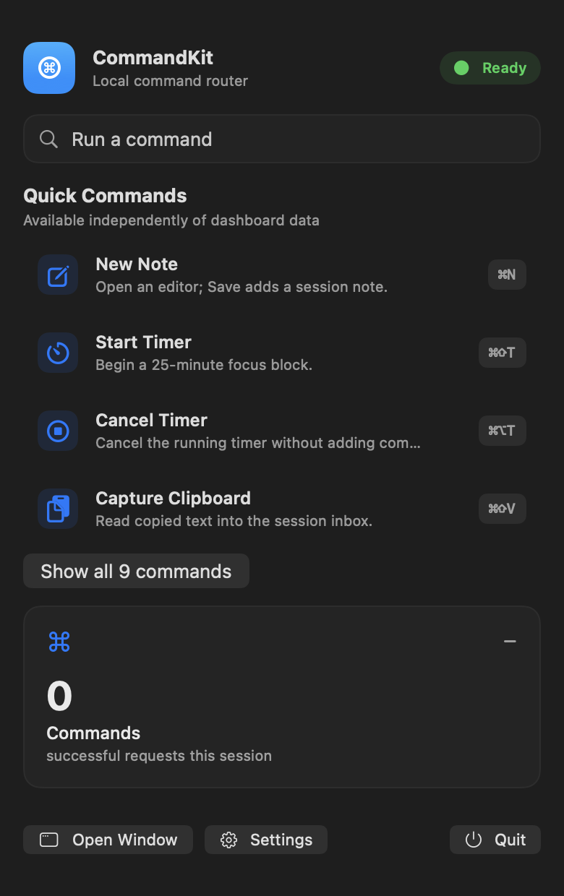

# MacMenuBarCommandKit

Reusable SwiftUI command shell and a small, session-only macOS demo.

[](https://www.swift.org)
[](https://developer.apple.com/macos/)
[](https://github.com/mikonyaa/MacMenuBarCommandKit/actions/workflows/ci.yml)
[](LICENSE)

Part of [Apple Design Templates](https://github.com/mikonyaa/Apple-Design-Templates). [Русский](README.ru.md).

This candidate is `0.3.0-rc.1`. It is a release candidate with explicit [validation results and pending gates](Docs/Validation-0.3.0-rc.1.md), not a production-readiness score. Stable `0.2.0` remains available.

[Native partial capture assembly](Assets/GIFs/rc-native-content-captures.gif) · [coverage/provenance](Docs/Evidence/capture-provenance.json)

The package provides metadata-driven commands, a dynamic registry, menu/dashboard/palette surfaces, native Settings and Launch at Login recovery. Apps own IDs, synchronous throwing handlers, data and platform actions. No mandatory network, account, analytics or runtime dependency is introduced.

## Included

- Product/module `MacMenuBarCommandKit`, Swift tools 6.0, macOS 14 minimum.
- A demo Xcode project with model and native UI test targets.
- Public observation through CommandStore alone, including catalog replacement and current metadata execution.
- Native scrolling, keyboard selection/Return/Escape, selected AX traits and outcome announcements. Active-window focus, VoiceOver and full XCUI have separate acceptance gates.
- Typed latest execution result with source-compatible summary access; failure icons and clearly labelled attempts/samples.
- Injected UserDefaults with a default-compatible prefix, theme/menu presentation, sample toggle and system-derived login status.
- Hash-verified XcodeGen 2.45.4 / SwiftLint 0.65.0, compatibility/current CI, independent public consumers and owned process tooling.

## Demo actions

| Command | Behavior |
| --- | --- |
| New Note · ⌘N | Opens an editor; a nonempty Save adds an entry; Cancel adds none |
| Start Timer · ⌘⇧T | Starts a 25-minute deadline; repeated Start while running fails |
| Cancel Timer · ⌘⌥T | Cancels without adding completed focus time |
| Capture Clipboard · ⌘⇧V | Explicitly reads text into the session inbox; empty/large text fails |
| Copy Status Report · ⌘⇧C | Writes session status; rejected writes are failures |
| Clear Inbox · ⌘⇧X | Deletes all entries; one Undo Clear is available until the next inbox change |
| Toggle Dashboard Focus · ⌘⌥F | Changes only the dashboard badge, not system Focus/Do Not Disturb |
| Open Dashboard · ⌘D | Opens or brings forward the workspace |
| Open Settings · ⌘, | Opens separate native Settings |

Inbox entries have stable IDs and typed note/clipboard kinds. Select one to read, copy or delete its full text. Storage is **session only**: text is lost on app quit or Clear. Limits are 50 entries including samples and 16,384 UTF-8 bytes per entry. Disabling sample data removes labelled samples while preserving real session entries and timer/history state. Timer progress is derived from the clock/deadline and reconciled on foreground/wake; completed time is counted at finish.

## Preview

The RC's own native content views were captured at the recorded implementation SHA. WindowServer capture was denied (`CGPreflightScreenCaptureAccess = false`, window capture exit 1); system privacy settings were left unchanged. The fallback omits some layer-backed/sidebar/native controls. These artifacts are explicitly **partial**, and a complete visual capture remains pending.

The old PNG/GIF with a stale Notifications placeholder were removed. [Current partial captures](Docs/Evidence/capture-provenance.json) include Settings without that toggle. The menu view is hosted in a native capture window and does not prove a system status-item click. The GIF is an assembly of partial PNGs, not an interaction recording.



## Run and adopt

Use a Mac with Apple SDKs. The package declares tools 6.0/macOS 14; consult [validation](Docs/Validation-0.3.0-rc.1.md) for actually tested compiler/OS versions. Open `Examples/CommandKitDemo/CommandKitDemo.xcodeproj`, select CommandKitDemo, and run on My Mac. XcodeGen 2.45.4 reproduces the checked-in project.

```bash
./script/build_and_run.sh
./script/build_and_run.sh --verify
```

The script builds before launch, uses its own DerivedData and a new LaunchServices instance, and stops only the returned PID after validating its paths. `run` waits until Quit or Ctrl-C. Verify checks an actual private-pasteboard write/readback and an open window. It never kills apps by a shared name.

Use the public product with your own identifiers and metadata. For this candidate, pin the exact prerelease:

```swift
.package(url: "https://github.com/mikonyaa/MacMenuBarCommandKit.git", exact: "0.3.0-rc.1")
// Target dependency:
.product(name: "MacMenuBarCommandKit", package: "MacMenuBarCommandKit")
```

```swift
let exportID: CommandID = "myapp.export.summary"
let command = CommandItem(
    id: exportID, title: "Export Summary", subtitle: "Save a local summary.",
    systemImage: "square.and.arrow.down", category: .productivity,
    shortcut: CommandShortcut(modifiers: [.command, .shift], key: "E")
)
let registry = CommandRegistry(commands: [command])
registry.register(exportID) { current in
    try exportSummary() // Your app owns this function and its side effect.
    return .success("Exported \(current.title).")
}
let store = CommandStore(registry: registry)
```

Create and observe these MainActor objects from a MainActor context. Observe only `store` in a SwiftUI surface; `registry.replaceCommands(...)` invalidates it without changing query. `store.perform(id)` and `store.perform(oldItem)` resolve current metadata; removed IDs fail. Read `latestResult` for severity. Existing published `lastActionSummary` remains available. The package's registry/dashboard start empty; demo IDs, fixtures, clipboard and timer stay in Examples.

## Verification and documentation

```bash
swift test
swiftlint lint --strict
xcodebuild -project Examples/CommandKitDemo/CommandKitDemo.xcodeproj -scheme CommandKitDemo -destination 'platform=macOS' CODE_SIGNING_ALLOWED=NO build
bash -n script/build_and_run.sh
zsh -n Scripts/record_showcase.sh
git diff --check
```

[Native acceptance](Docs/NativeAcceptance.md) gives the model/full UI test commands, consumer setup, signed-login procedure, accessibility/sleep checks and factual result form. Prepared tests/checklists are not completed native gates. No developer pilot, Instruments study, leak or speedup is claimed.

- [Getting started](Docs/GettingStarted.md), [Architecture](Docs/Architecture.md), [Commands](Docs/Commands.md)
- [Migration 0.1.0 → 0.2.0](Docs/Migration-0.2.0.md), [Migration 0.2.0 → 0.3.0 RC](Docs/Migration-0.3.0.md)
- [Customization](Docs/Customization.md), [Accessibility](Docs/Accessibility.md)
- [RC release notes](Docs/ReleaseNotes-0.3.0-rc.1.md), [Release checklist](Docs/ReleaseChecklist.md)
- [Collection/profile proposal](Docs/CatalogProposal-0.3.0.md)

MIT. Use the package in personal, commercial or open-source apps.
