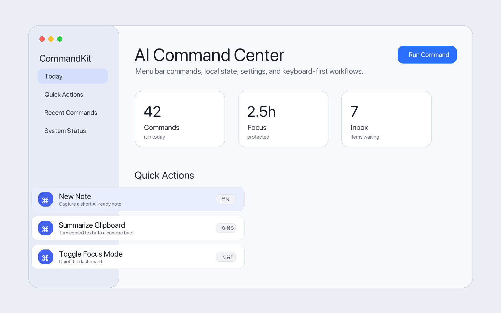
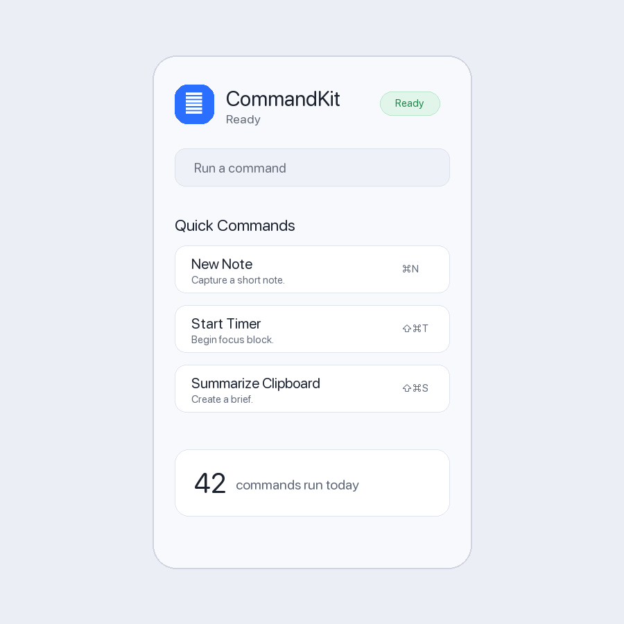
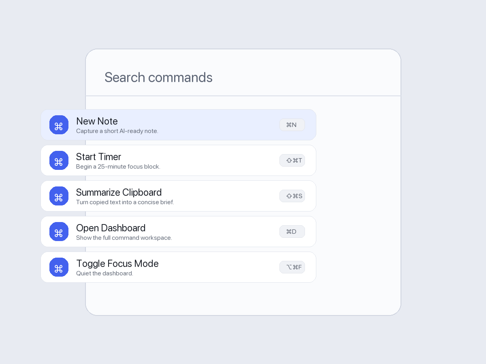
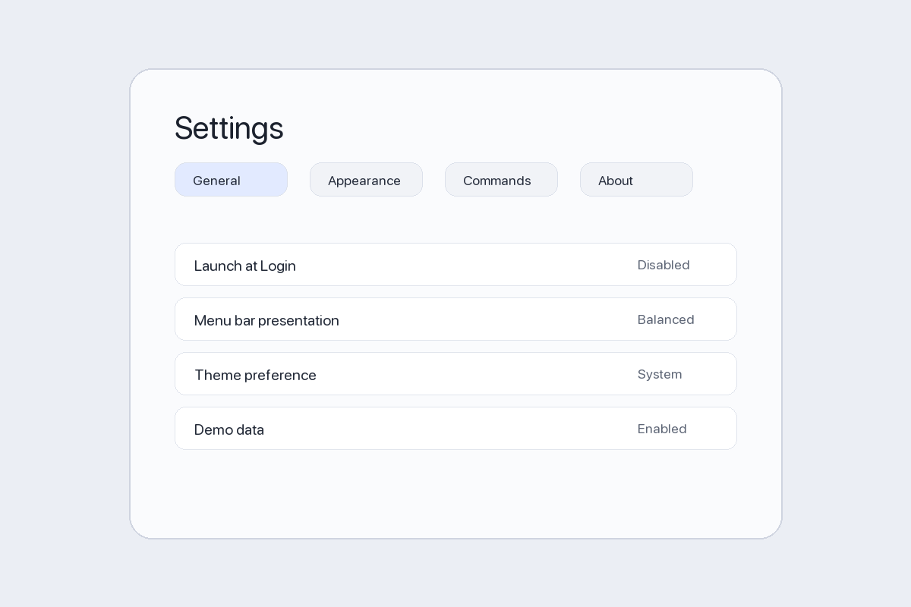

# MacMenuBarCommandKit

Production-oriented SwiftUI menu bar command shell for macOS.

[](https://www.swift.org)
[](https://developer.apple.com/macos/)
[](https://github.com/mikonyaa/MacMenuBarCommandKit/actions/workflows/ci.yml)
[](LICENSE)

Part of the [Apple Design Templates](https://github.com/mikonyaa/Apple-Design-Templates) collection.



MacMenuBarCommandKit is a reusable starter kit for building native menu bar utilities: AI assistants, timers, clipboard tools, quick notes, system monitors, and productivity apps. It combines a `MenuBarExtra`, a real main window, command palette, keyboard shortcuts, native Settings, Launch at Login support, deterministic local data, and a clean Swift Package API.

## Included

- `MacMenuBarCommandKit`, a zero-dependency Swift Package.
- A runnable macOS demo app: `Examples/CommandKitDemo/CommandKitDemo.xcodeproj`.
- Dock-visible launch behavior with a menu bar extra.
- `CommandPalette` with search, shortcuts, categories, and metadata-first commands.
- `CommandRegistry`, `CommandStore`, `DashboardStore`, `SettingsStore`, and `LaunchAtLoginService`.
- Native SwiftUI `Settings` scene with General, Appearance, Commands, and About tabs.
- `SMAppService` Launch at Login wrapper with enabled, disabled, approval, unsupported, and error states.
- Loading, empty, error, and loaded dashboard states.
- Unit tests, GitHub Actions, issue templates, changelog, and release checklist.
- English and Russian documentation.

## Preview

| Main window | Menu dashboard |
| --- | --- |
|  |  |

| Command palette | Settings |
| --- | --- |
|  |  |

## Requirements

- Xcode 26 or newer.
- Swift 6.
- macOS 14 or newer.

## Run the demo

Open the checked-in Xcode project:

```bash
open Examples/CommandKitDemo/CommandKitDemo.xcodeproj
```

Select the `CommandKitDemo` scheme and run on My Mac.

Or use the Codex/local run script:

```bash
./script/build_and_run.sh
./script/build_and_run.sh --verify
```

Optional: regenerate the Xcode project with XcodeGen:

```bash
cd Examples/CommandKitDemo
xcodegen generate
open CommandKitDemo.xcodeproj
```

## Add a command

Commands are metadata first. Add a `CommandItem` and register behavior where your app owns platform actions:

```swift
let command = CommandItem(
    id: "export-summary",
    title: "Export Summary",
    subtitle: "Save the latest AI summary as Markdown.",
    systemImage: "square.and.arrow.down",
    category: .productivity,
    shortcut: CommandShortcut(modifiers: [.command, .shift], key: "E"),
    action: .summarizeClipboard
)

registry.replaceCommands(CommandItem.demoCommands + [command])
registry.register(.summarizeClipboard) { command in
    print("Run \(command.title)")
}
```

See [Commands](Docs/Commands.md) for extension patterns.

## Replace demo data

Replace `ActivityItem.demo`, `MetricCard.demo`, or initialize `DashboardStore` with your product data. The template has no network, backend, analytics, or paid dependency.

## Project structure

```text
MacMenuBarCommandKit/
├── Sources/MacMenuBarCommandKit/   Reusable package
├── Tests/MacMenuBarCommandKitTests/
├── Examples/CommandKitDemo/        Runnable macOS app
├── Docs/
├── Assets/
├── Tools/
└── script/build_and_run.sh
```

## Documentation

- [Getting started](Docs/GettingStarted.md)
- [Architecture](Docs/Architecture.md)
- [Commands](Docs/Commands.md)
- [Customization](Docs/Customization.md)
- [Accessibility](Docs/Accessibility.md)
- [Release checklist](Docs/ReleaseChecklist.md)
- [Beginner AI learning prompt](Docs/LearningPrompt.md)

## Verification

```bash
swift test

xcodebuild \
  -project Examples/CommandKitDemo/CommandKitDemo.xcodeproj \
  -scheme CommandKitDemo \
  -destination 'platform=macOS' \
  CODE_SIGNING_ALLOWED=NO \
  build
```

## Roadmap

The 0.1.0 scope is intentionally focused. Future releases should stay optional:

- App Intents sample commands.
- Optional no-Dock accessory mode recipe.
- UI tests for command palette keyboard navigation.
- Notification authorization recipe.
- Real app icon and signed helper documentation.

## License

MIT. Use it in personal, commercial, and open-source projects.
